<p align="center">
  
</p>

<p align="center">
  <a href="https://linkedin.com/in/harshith-ashok/"></a>
  <a href="https://portfolio.harshithashok.com"></a>
  <a href="mailto:harshith.7k10@gmail.com"></a>
</p>


## `$ cat about.txt`

```text
name        Harshith Ashok
location    Chennai, India
education   B.Tech CSE @ SRM Institute of Science & Technology (2024-2028)
now         Research Intern @ Madras Institute of Technology
past        SWE Intern @ IFF  |  SWE Intern @ LyncSpace Software Services
focus       LLM-grounded systems, RAG pipelines, backend APIs, embedded, terminal-first tooling
learning    AWS Solutions Architect Associate, Japanese
```


## `$ ls ~/languages`

<table>
  <tr>
    <td align="center"><br><sub><b>Python</b></sub></td>
    <td align="center"><br><sub><b>TypeScript</b></sub></td>
    <td align="center"><br><sub><b>JavaScript</b></sub></td>
    <td align="center"><br><sub><b>C</b></sub></td>
    <td align="center"><br><sub><b>C++</b></sub></td>
    <td align="center"><br><sub><b>Bash</b></sub></td>
  </tr>
</table>

```text
ai/agentic   LangChain  Ollama  OpenAI  Qdrant  LangGraph
frontend     React  Vue.js  Angular  Svelte  Tailwind CSS
backend      FastAPI  Node.js  Express  NestJS  Django  Flask
data/infra   PostgreSQL  MySQL  Supabase  Docker  GitHub Actions
embedded     ESP32  Raspberry Pi  Arduino  Jetson Nano  MQTT
environment  Arch  Debian  Gentoo  Git  VS Code  PyCharm
```


## `$ ls ~/projects`

| Project | Description | Notes |
| :-- | :-- | :-- |
| [**SAGE**](https://github.com/harshith-ashok/sage) | Sovereign Agentic RAG Engine | Agentic, retrieval-augmented pipeline |
| [**Insurance Claim Agent**](https://github.com/harshith-ashok/insurance_claim_agent) | RAG assistant with guardrails | Tested on a 53-question golden set. The results showed one of my own features hiding correct answers, so I removed it. GitHub Actions runs lint, type checks and tests on every PR |
| [**PersonaLens**](https://github.com/harshith-ashok/persona-lens) | Memory aid | LLM-based assistant |
| **Plotter** (research, MIT) | RGB + thermal detection prototype | F1 0.65 (RGB) and 0.77 (thermal) on small 12-frame samples at a lenient overlap threshold. On a small KAIST sample, both-camera detections were 9/9 correct vs 7/10 for a single camera. Early signals, not final results |


## `$ git log --achievements`

```text
[x] Merged PR: improved ARM64 support in Frappe Docker
[x] Shipped to Frappe Suite: YouTube embeds and Google Drive uploads
[x] Owned 2 of 8 modules of a student ERP at IFF (FastAPI, MySQL, SQL reports) in a four-engineer SAFe team
[x] Organised the Stack Roulette Hackathon: 50 participants, randomly assigned tech stacks
[x] Founded Logic Play, a technical club at SRM
[ ] AWS Solutions Architect Associate   (in progress)
[ ] Japanese                            (in progress)
```


## `$ man harshith`

| Area | Focus |
| :-- | :-- |
| **LLM decision assistants** | Strict grounding, structured JSON output, minimal hallucination |
| **Agentic pipelines** | LangGraph orchestration, retrieval-augmented reasoning, multi-agent task DAGs |
| **Enterprise / ERP** | Frappe apps, custom workflows, relational data models |
| **Automation & tooling** | Scraping, dashboards, DevOps/MLOps tooling |
| **Embedded & IoT** | Sensor networks, MQTT telemetry (ESP32 to Raspberry Pi), FastAPI/WebSocket bridges, edge displays |

<p align="center">
  <sub><code>exit 0</code> · open to internships and collaboration · <a href="mailto:harshith.7k10@gmail.com">say hi</a></sub>
</p>
